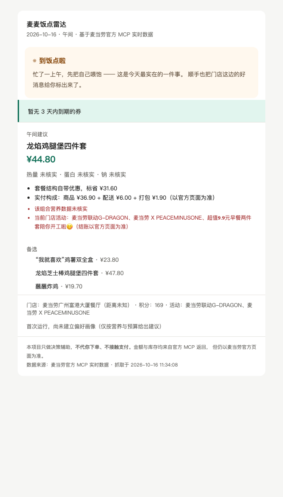
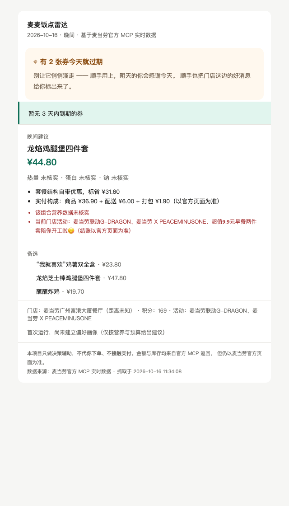
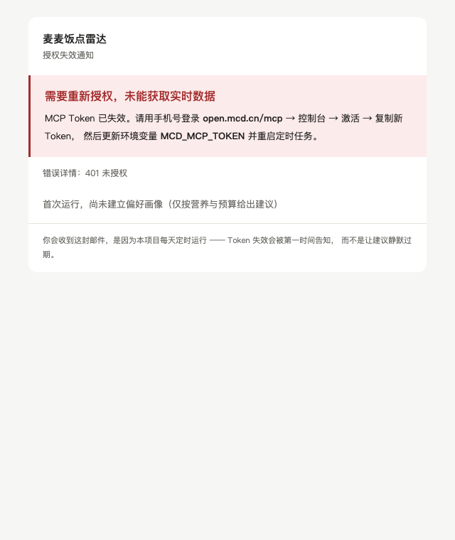

# 麦麦饭点雷达

> **100 个麦当劳 Skill 都在等你开口。只有这一个，每天饭点主动来找你。**

每天 09:00 / 11:00 / 16:30 / 20:00，先跟你说句话，再帮你**领券、算清这顿最省多少、
盯住快过期的券**，然后发到你邮箱。基于麦当劳官方 MCP，**不猜价格、不代下单、不碰支付**。

> 「今天还没顾上吃饭 —— 不催你，就是想让你知道，现在补一顿比空着撑到明天温柔得多。」
> 「今天不容易吧。吃顿想热的，剩下的事明天再处理。」

<div align="center">


**↓ 这是它每天发给你的邮件（真实麦当劳 MCP 数据）↓**





<br>

[](#快速体验30秒)
[](#快速体验30秒)
[](#快速体验30秒)
[](tests/test_all.py)
[](https://mcp.mcd.cn)
[](./LICENSE)

**`python demo.py`** — 零依赖 · 不用申请 Token · 不联网 · 30 秒看到上面这些效果

</div>

---

## 30 秒试一下

```bash
git clone https://github.com/f-cfan/mcd-meal-radar.git
cd mcd-meal-radar
python demo.py
```

不需要 MCP Token，不装任何第三方库，也不联网 —— `fixtures/` 里存着 18 份
**真实 MCP 响应录制**，跑通四条链路：午间推荐 / 券过期提醒 / Token 失效降级 / 单位陷阱。

```bash
python tests/test_all.py     # 117 个单测
```

---

## 这个项目解决什么问题

现有的麦当劳 MCP 消费类工具，几乎都是同一个形态：**你问，它答**。

本项目是另一种形态：**它定时来找你**。

| | 一次性问答工具 | 麦麦饭点雷达 |
|---|---|---|
| 触发方式 | 用户主动提问 | 每日四档定时（09:00 / 11:00 / 16:30 / 20:00） |
| 使用频率 | 想起来才用 | 每天饭点自动送达 |
| 券过期 | 忘了就错过 | 20:00 专门提醒，还有 1 天/3 天两级预警 |
| 自动领券 | 需要手动操作 | 每日 09:00 自动领取 |
| 门店活动 | 不会主动告诉你 | 活动层随建议一起提示 |
| Token 过期 | 跑完就结束，碰不到 | **会必然遇到 → 已设计降级链路** |

最后一行是本项目最核心的工程判断，详见下文「为什么专门设计了 Token 降级」。

---

## 快速体验（30 秒）

```bash
git clone https://github.com/f-cfan/mcd-meal-radar.git
cd mcd-meal-radar
python demo.py
```

**零第三方依赖 · 不需要 MCP Token · 不联网。**

`fixtures/` 中存放 18 份响应样本（其中 18 份是 2026-10-15 真实调用录制），`demo.py` 读取它们跑通四条链路：

```
链路 A  午间推荐      → 四层约束求解，输出可解释建议
链路 B  Token 失效    → 优雅降级，生成续授权邮件
链路 C  券过期提醒    → 20:00 档位的实际效果
链路 D  单位陷阱      → 演示最容易踩且后果最严重的坑
```

跑完后用浏览器打开 `out/demo_digest.html`，看到的就是真实推送的邮件效果。

也可以直接看已入库的两份样例（无需运行）：

| 样例 | 文件 |
|---|---|
| 日常推荐邮件 | [`docs/samples/sample-email-digest.html`](docs/samples/sample-email-digest.html) |
| Token 失效邮件 | [`docs/samples/sample-email-token-expired.html`](docs/samples/sample-email-token-expired.html) |

```bash
# 跑单测（76 个，覆盖单位换算 / 场景矩阵 / 字段缺失 / 双通道 / 画像推导 / 文档一致性）
python tests/test_all.py
```

---

## 四层约束引擎

推荐不是「让模型觉得哪个好」，而是四层约束依次求解，每层都可解释、可复现。

**个性化是真的**：偏好层从 `order-list` 真实历史订单自动推导，不是让模型猜。推导规则
全部可查（频次、标签聚合、门店频次、客单价、用券率），并在邮件底部展示依据，
方便你发现偏差并纠正。

> 实测坑：新注册账号的 `order-list` 返回 `data: {}`（空对象），此时会显示
> 「首次运行，尚未建立偏好画像」并降级为「仅按营养与预算给建议」——
> **不假装有历史，也不编造偏好**。

```
① 偏好层  你吃你的    order-list → 本地画像 → 口味标签 / 忌口 / 常点
② 钱包层  你花你的    券组合枚举 → calculate-price 真实核价
③ 身体层  你不能垮    热量 / 钠 硬上限过滤
④ 活动层  现在有什么  campaign-calendar → 门店活动（仅提示，不主导排序）
```

### 输出示例

```
推荐：麦辣鸡腿汉堡三件套
  价格：¥33.50
  用券：无糖饮品立减4.5元券
  营养：热量 742 kcal · 蛋白 32 g · 钠 1180 mg
  理由：
    · 命中你的常点「麦辣鸡腿汉堡三件套」
    · 套餐结构自带优惠，标省 ¥13.50
    · 叠加当前门店券「无糖饮品立减4.5元券」，面值 ¥4.50
    · 该券 1 天后过期
    · 已通过 calculate-price 真实核价
  注意：
    ! 当前门店活动：秋日金黄薯条节、会员日双倍积分（结账以官方页面为准）
```

每条推荐都告诉你**为什么**和**注意什么**，而不是给一个不透明分数。

---

## 两条不可妥协的纪律

### 纪律一：枚举与计价分离，绝不估价

一个「帮你省钱的 AI」最容易犯的错误是**编造价格**。

本项目的做法：

```
本地枚举候选组合  →  对每个组合调 calculate-price  →  用真实返回定价
```

**查不到报价的组合留空，标注「未核价」，不用标签价推算、不让模型估算。**

```
推荐：麦辣鸡腿汉堡三件套
  价格：¥33.50          ← 来自 calculate-price 真实返回
  备选：麦辣鸡腿汉堡
  价格：未核价           ← 没查到如实说，绝不猜
```

### 纪律二：只推荐，不下单

官方 MCP 的 33 个 Tool 中**没有任何支付工具**。`create-order` 返回的是「订单详情与**支付链接**」，不是付款码。这是官方刻意的设计边界 —— 支付保留人工确认，责任划分清晰。

本项目尊重这个边界：

- ✅ 调用 7 个只读 Tool + 1 个领券 Tool
- ❌ **不调用** `create-order` / `cancel-order` / `mall-create-order` / `party-order-create` / `draw-lottery`
- ✅ 只把决策做到「就差你确认」

单测 `TestNoOrderingTools` 会扫描源码，确保没有任何下单工具调用混进来。

---

## 真实 Token 实测验证

本项目不是纸面设计 —— 全部能力已用真实 MCP Token 跑通。

| 能力 | 实测结果（2026-10-15） |
|---|---|
| 外送可配送门店 | ✅ 真实门店 + `beCode` + 预约时段 |
| 真实菜单 | ✅ 单店 **134 项**（含真实编码与价格） |
| 真实计价 | ✅ `calculate-price` 返回含配送与打包的实付金额 |
| 真实营养 | ✅ **158 项**标准单品营养 |
| 真实活动 | ✅ **16 个**进行中/未来活动 |
| 真实积分 | ✅ `availablePoint` 读取成功 |
| 单测 | **117 passed** |

**推荐结果为真实数据**：

```
龙焰鸡腿堡四件套
  实付 ¥44.80
  理由：
    · 命中你的常点「龙焰鸡腿堡四件套」
    · 套餐结构自带优惠，标省 ¥31.60
    · 实付构成：商品 ¥36.90 + 配送 ¥6.00 + 打包 ¥1.90
```

### 实测发现的 6 个坑（官方文档未写明）

这些是**真实调用中撞出来的**，不是从文档读到的：

| # | 坑 | 后果 |
|---|---|---|
| A | 响应是「文本说明 + 原始 JSON」双层结构 | 直接当 JSON 解析会全部失败 |
| B | `list-nutrition-foods` 返回 **DSL 字符串**而非 JSON | 需自写解析器 |
| C | 营养表只覆盖标准单品，菜单以套餐为主 | **命中率仅 22%**（29/134） |
| D | 活动同一内容同时出现在「往期回顾」与「今日」段 | 只看字样会误杀进行中的活动 |
| E | 外送必填参数是 `addressId + beType + beCode` | 漏传 `beCode` 时**成功但价格为 0** |
| F | 实付含配送与打包费 | 只看商品价会让用户以为算错 |

其中 **E 最危险** —— API 返回成功但数据是空的，静默失败不易察觉。
本项目在核价时强制校验 `price` 字段非空才写入计价表，否则标为「未核价」。

关于坑 C：官方**没有提供套餐到单品的成分映射**。这是数据缺口而非实现缺陷，
所以本项目选择**如实显示「营养未提供」**，而不是估算或按 0 填充。

完整实测记录见 [MCP_INTEGRATION.md](MCP_INTEGRATION.md) 第七章。

---

## 为什么专门设计了 Token 降级

这是本项目区别于所有其他参赛作品的地方。

**事实**：官方未公布 MCP Token 的有效期天数，但实测确认 Token 是硬门槛 —— 无 Token 时端点直接拒绝（HTTP 403 / `code: 0001`）。

**推论**：

| 项目形态 | 会不会遇到 Token 过期 |
|---|---|
| 一次性问答 Skill | **不会** —— 跑完就结束 |
| 定时任务 | **必然会** —— 每天运行 |

绝大多数同赛项目只跑一次，所以天然遇不到这个问题。
**但凡它真的每天跑，第三天就会静默失败。**

所以本项目实现了一条完整的降级链路：

```
MCP 返回 401
    ↓
捕获 TokenExpired（不抛给用户）
    ↓
读取 data/last_snapshot.json 缓存快照
    ↓
发送「需要重新授权」邮件：续授权步骤 + 错误详情 + 缓存快照摘要
```

```
┌─────────────────────────────────────┐
│  ⚠️ 需要重新授权，未能获取实时数据    │
│                                     │
│  MCP Token 已失效。请用手机号登录     │
│  open.mcd.cn/mcp → 控制台 → 激活 →   │
│  复制新 Token，然后更新环境变量       │
│  MCD_MCP_TOKEN 并重启定时任务。       │
│                                     │
│  缓存快照（抓取于 10-12 22:05）：      │
│  6 项菜单 · 3 张券                    │
└─────────────────────────────────────┘
```

**把必然发生的断点，做成被设计过的用户体验。**

---

## 安装与配置

### 1. 获取 MCP Token

用手机号登录 [open.mcd.cn/mcp](https://open.mcd.cn/mcp) → 控制台 → 激活 → 复制 Token。

### 2. 配置推送通道

**推荐：Agent Mail** —— QQ 邮箱团队的 Agent 专属邮箱服务，免授权码、扫码即用。

```bash
npm install -g @tencent-qqmail/agently-cli
agently-cli auth login          # OAuth 设备流，会自动打开浏览器，微信扫码授权
agently-cli +me                 # 查看你的 Agent 邮箱地址
```

授权完成后**零配置即可发送** —— 程序会自动从 CLI 读取收件地址，无需手填。

收件人解析优先级：

```
显式参数  >  RADAR_TO（.env）  >  自动从 CLI 解析
```

因此如果你想把推送发到**自己的日常邮箱**（而不是 Agent 邮箱），
在 `.env` 里设 `RADAR_TO=你的邮箱` 即可 —— 发件人仍是 Agent 专属地址，
不会暴露你的个人身份。

<details>
<summary>WorkBuddy 用户其实不需要装 CLI</summary>

WorkBuddy 已内置 Agent Mail 能力（首页「更多 → 我的邮箱」启用即可），
直接在对话里说「帮我发一封邮件」就行。

装 CLI 的意义在于：**让 cron / launchd 定时任务能无人值守跑**。
内置能力只在对话内可用，脚本侧调不到。

</details>

<details>
<summary>为什么优先用 Agent Mail 而不是自建 SMTP？</summary>

| | Agent Mail | 自建 SMTP |
|---|---|---|
| 需要授权码 | ❌ 不用 | ✅ 需要 16 位短信验证 |
| 发件地址 | 专属地址（`agent.qq.com` 域下），与个人邮箱隔离 | 用你自己的邮箱，需给程序授权码 |
| 适配 Agent | 官方一等公民 | 自己处理发信逻辑 |
| 额度 | 每地址 1GB、每天 50 封 | 取决于邮箱设置 |

**隐私设计**：发件人始终是 Agent 专属地址（`agent.qq.com` 域下的独立地址），
与你本人的私人邮箱无关 —— 既不暴露私人地址，也不用把邮箱授权码交给任何第三方程序。
收件人可以是你自己的任意邮箱。

短信验证环节需要你本人的手机号，**任何第三方工具都无法代替** —— 这是账号安全设计。
所以如果你在 WorkBuddy 里用，直接走 Agent Mail 就完全绕开了这个问题。

</details>

**备选：SMTP** —— 适合部署在没有 Agent 的环境（自己的服务器、CI 等）：

```bash
# 先跑自检，它会打开官方授权码页面
python scripts/setup_mail_auth.py
```

官方路径：`mail.qq.com` → 设置 → 账号与安全 → 开启 IMAP/SMTP → 短信验证 → 复制 16 位授权码。

然后配置 `.env`：

```bash
cp .env.example .env
```

```ini
MCD_MCP_TOKEN=你的 Token

# 推送通道：auto（Agent 优先，失败回落）/ agent / smtp
MAIL_CHANNEL=auto

# 外送场景的配送地址（delivery-query-stores 必填）
# 填 addressId；或留空并设 MCD_ADDRESS_PICK=first 让程序从地址簿取第一项
MCD_ADDRESS_ID=

# 仅 SMTP 通道需要以下四项（走 Agent Mail 时都不需要）
SMTP_HOST=smtp.qq.com
SMTP_PORT=465
SMTP_USER=你的邮箱
SMTP_PASSWORD=SMTP 授权码
RADAR_TO=收件邮箱
```

⚠️ **关于 `MCD_ADDRESS_PICK`** —— 程序**不会**静默取地址簿第一条。
「发到哪个地址」是有后果的选择，需要你显式指定：

```ini
MCD_ADDRESS_PICK=first   # 取地址簿第一项
MCD_ADDRESS_PICK=1       # 取第二项（索引从 0 起）
```

这与「金额绝不用估算」是同一条纪律：能自动的自动化，不能猜的不猜。

### 3. 配置 MCP 连接

把 `mcp-config.example.json` 中的配置合入你的 MCP 客户端配置文件
（如 `~/.workbuddy/mcp.json`）。

### 4. 安装为定时任务

```bash
# 看看四档任务跑起来是什么样（离线，不发邮件）
python scheduler.py --fixture --all

# 实际发一封试试
python scheduler.py --fixture --now lunch --send

# 接入真实数据
export MCD_MCP_TOKEN=...
python scheduler.py --live --all

# 打印 crontab 配置示例
python scheduler.py --install-cron
```

推荐使用系统 cron 或 WorkBuddy 自动化任务，详见 [docs/SCHEDULE.md](docs/SCHEDULE.md)。

### 5. 配置饮食约束（可选）

创建 `data/policy.json`：

```json
{
  "max_kcal": 900,
  "max_sodium_mg": 2000,
  "budget_yuan": 45,
  "excluded_keywords": ["辣椒"]
}
```

不创建则使用默认值，不阻塞运行。

---

## 使用示例

### 场景一：工作日午餐

```
11:00  邮件送达
       你只关心两件事：今天吃什么、能不能便宜点
       这封邮件 20 秒内回答完这两件事
```

### 场景二：券要过期了

```
20:00  邮件送达
       ⚠️ 有 2 张券即将过期
          · 无糖饮品立减4.5元券 · 今天到期
          · 早餐时段立减3元券 · 2 天后过期
```

### 场景三：Token 失效

```
09:00  你收到的是一封「需要重新授权」邮件
       而不是「服务已悄悄停止 3 天」
```

---

## 项目结构

```
mcd-meal-radar/
├── demo.py                  # 30 秒演示入口，零依赖零 Token
├── scheduler.py             # 四档定时任务调度器
├── src/
│   ├── mcd_adapter.py       # MCP 协议 ↔ 领域模型，含单位换算与场景矩阵
│   ├── collector.py         # 数据抓取编排（live / fixture 双源同出口）
│   ├── solver.py            # 四层约束求解引擎
│   ├── mailer.py            # 邮件渲染（HTML + 纯文本）
│   └── mail.py              # 双通道推送（Agent Mail 优先 / SMTP 备选）
├── fixtures/                # 18 份响应样本（18 份真实调用录制）
├── tests/test_all.py        # 117 个单测
├── assets/                  # Banner、架构图
├── docs/                    # 部署与提交清单
├── MCP_INTEGRATION.md       # MCP 集成说明与实测踩坑记录
├── CONTEST_DECLARATION.md   # 参赛声明（官方原文，逐字未改）
├── mcp-config.example.json  # 脱敏 MCP 配置
└── workbuddy.md             # WorkBuddy 开发对话上下文
```

---

## 隐私与安全

| 数据 | 处理方式 |
|---|---|
| MCP Token / SMTP 授权码 | 仅存环境变量或 `.env`（已 `.gitignore`），代码与日志中无明文 |
| 配送地址 | 仅存于 MCP 账户侧，本项目不缓存地址明文 |
| 偏好画像（口味/忌口/常点） | 仅存本地 `data/profile.json`（已 `.gitignore`），**不外传、不上传** |
| 邮件内容 | 仅发往你自己配置的收件邮箱 |

**本项目无第三方数据分析、无遥测上报。** 偏好画像随时可删除 `data/` 目录。

---

## 已知限制

| 限制 | 说明 |
|---|---|
| Token 需定期更新 | 官方未公布有效期，无法自动续期，只能提醒用户手动更新 |
| 外送地址需手工创建 | MCP 不支持自动定位，需先用 `delivery-create-address` 建地址簿 |
| 部分门店营养数据不全 | 官方数据本身字段缺失，此时显示「未核实」而非猜测值 |
| 不含库存实时查询 | 官方未开放库存接口，因此不承诺「有货」，仅展示门店可用性 |
| 外送场景参数需实测 | fixtures 中外送参数为流程设计值，首次接入真实外送时需按实际响应校正 |

---

## 致谢

数据来源：[麦当劳官方 MCP 服务](https://mcp.mcd.cn)。
本项目为个人作品，非麦当劳官方产品，与麦当劳无任何隶属或背书关系。
餐品信息、价格与供应状态以麦当劳官方渠道实时结果为准。
